<div align="center">

# 🛡️ CertiGuard

### Digital Certificate Verification & Revocation Platform

**Trust every credential. Verify every certificate.**

A full-stack platform for issuing digital certificates, verifying authenticity through QR codes or certificate IDs, and managing certificate validity and revocation.

<br/>

[](https://www.oracle.com/java/)
[](https://spring.io/projects/spring-boot)
[](https://nextjs.org/)
[](https://www.typescriptlang.org/)
[](https://www.postgresql.org/)

[Overview](#-overview) · [Features](#-key-features) · [Architecture](#-system-architecture) · [Setup](#-getting-started) · [UML](#-uml-designs)

</div>

---

## ✨ Overview

CertiGuard is designed to make digital credentials easier to issue, manage, and authenticate. Approved organizations can issue certificates, while recipients and members of the public can check a certificate's current status using its unique ID or QR code.

The platform brings together issuer onboarding, certificate generation, cryptographic integrity checks, public verification, expiry and revocation handling, and administrative monitoring in one application.

> [!IMPORTANT]
> A QR code is a convenient pointer to the official verification page—not proof of authenticity by itself. CertiGuard's backend must validate the certificate record and its current status.

## 🎯 The Problem We Address

Traditional certificate verification can be slow and difficult to scale. Static documents can be altered, and a document may remain in circulation after it has expired or been revoked. CertiGuard aims to make verification more accessible and consistent by providing a central verification workflow and certificate lifecycle controls.

## 🚀 Key Features

<table>
<tr>
<td width="50%" valign="top">

### 🔐 Identity & Access
- User registration and login
- JWT-based authentication
- Role-based access for administrators, issuers and holders
- Issuer application and approval workflow

</td>
<td width="50%" valign="top">

### 📜 Certificate Issuance
- Configurable certificate categories
- Server-generated certificate PDFs
- Unique certificate identifiers
- QR codes linked to public verification

</td>
</tr>
<tr>
<td width="50%" valign="top">

### 🧾 Integrity & Verification
- SHA-256 certificate hash
- RSA digital-signature generation and verification
- Public verification by certificate ID or QR
- Verification results for valid, expired, revoked or invalid records

</td>
<td width="50%" valign="top">

### 📊 Governance & Monitoring
- Certificate lifecycle management
- Verification history and audit records
- Rule-based fraud/anomaly alerts
- Administrative analytics and alert resolution

</td>
</tr>
</table>

*Feature descriptions follow the project's implementation progress report. Confirm each feature against the current build and end-to-end tests before describing it as production-verified.*

## 🔄 How CertiGuard Works

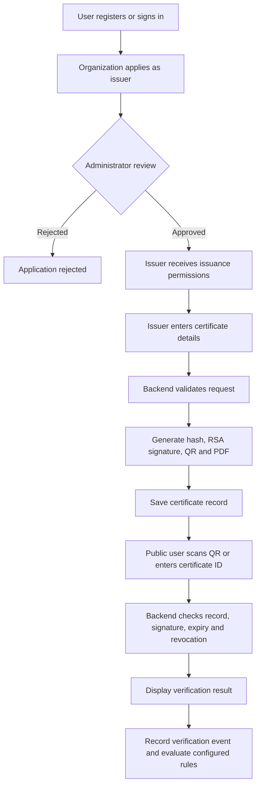

## 🧩 User Roles

| Role | Responsibilities |
|---|---|
| **System Administrator** | Review issuer applications, manage certificate types, oversee system activity and review analytics/alerts. |
| **Verified Issuer** | Issue certificates, view issued records and revoke certificates when authorized. |
| **Certificate Holder** | Access their own available certificate records and download or share verification links. |
| **Public Visitor** | Verify a certificate by ID or QR code without signing in. |

Authorization must be enforced by the backend. Hiding a frontend button is not a substitute for securing an API endpoint.

## 🏗️ System Architecture

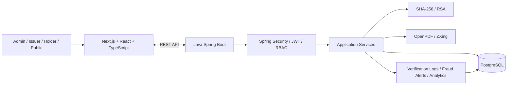

### Technology Stack

| Layer | Technologies |
|---|---|
| Frontend | Next.js, React, TypeScript, Tailwind CSS |
| Backend | Java 21, Spring Boot, Spring Web |
| Authentication & authorization | Spring Security, JWT, BCrypt, RBAC |
| Database | PostgreSQL, Spring Data JPA / Hibernate |
| Cryptographic operations | SHA-256, RSA digital signatures (`SHA256withRSA`) |
| Certificate documents | OpenPDF |
| QR codes | ZXing; `jsqr` for browser-side QR decoding |
| Build tools | Maven Wrapper, npm |
| Deployment target | Vercel for frontend; Render or equivalent for backend and managed database |

## 🧱 Project Modules

1. **Authentication & Identity Management** — registration, login, user profiles and protected access.
2. **Issuer Management** — issuer onboarding, approval/rejection and issuer trust information.
3. **Certificate Types & Issuance** — certificate categories, issue form, metadata and PDF generation.
4. **Cryptographic Services** — canonical certificate data, SHA-256 hashes and RSA signatures.
5. **QR & Public Verification** — QR scanning, public verification API and privacy-aware results.
6. **Lifecycle, Audit & Analytics** — expiry/revocation, verification records, rule-based alerts and administrative reporting.

## 🔒 Security Design

- **Passwords:** store BCrypt password hashes, never plaintext passwords.
- **Authorization:** enforce roles and record ownership in backend endpoints.
- **Issuer trust:** only approved issuers should be allowed to issue certificates.
- **Hash integrity:** SHA-256 detects changes when the calculated digest is compared with a trusted stored digest.
- **Digital signatures:** validate signatures against a trusted issuer public key. A hash alone does not prove who issued a certificate.
- **Privacy:** public responses must not disclose private keys, password hashes, tokens or internal audit metadata.
- **Secrets:** keep database credentials, JWT secrets and signing keys out of Git.
- **Transport:** use HTTPS for deployed environments.

> **Key-management note:** The implementation report describes RSA private-key material in issuer database fields. Before production use, assess this design and move private keys to protected key storage or encrypt them at rest with tightly restricted access. Never expose private-key fields through API responses.

---

## 📐 UML Designs

The full 10-page UML reference is available here:

**[📄 Open the complete UML diagrams PDF](docs/uml/Digital_Certificate_Platform_UML_Diagrams.pdf)**

The following diagrams are also embedded below as expandable previews. Click a heading to open its diagram.

<details>
<summary><strong>1 · Use Case Diagram</strong> — actors and system functions</summary>
<br/>

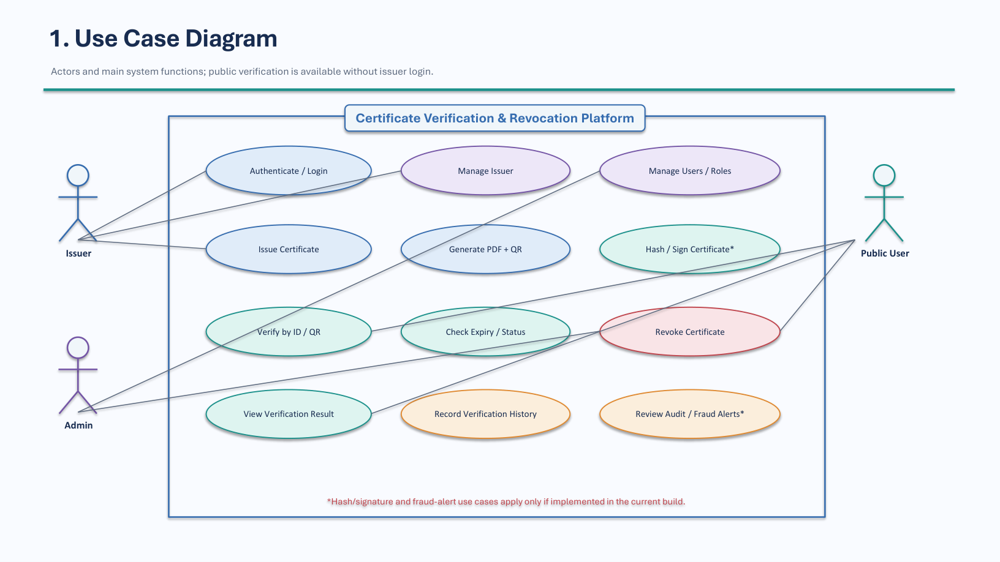

</details>

<details>
<summary><strong>2 · Domain Class Diagram</strong> — core entities and relationships</summary>
<br/>

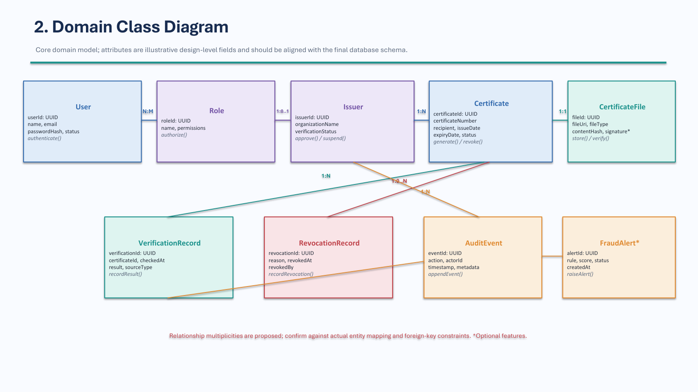

</details>

<details>
<summary><strong>3 · Sequence Diagram: Certificate Issuance</strong> — authorized issuance flow</summary>
<br/>

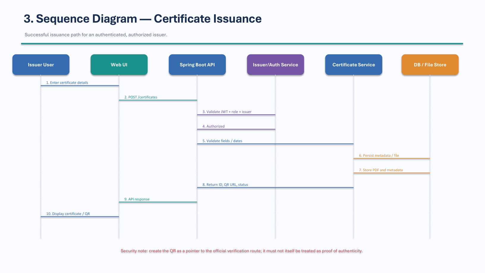

</details>

<details>
<summary><strong>4 · Sequence Diagram: Public Verification</strong> — QR/ID lookup and validation</summary>
<br/>

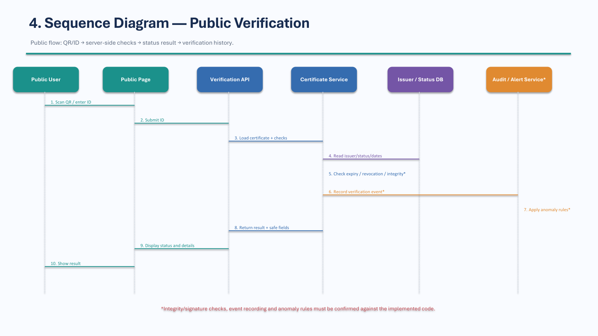

</details>

<details>
<summary><strong>5 · Activity Diagram: Certificate Lifecycle</strong> — onboarding to revocation</summary>
<br/>

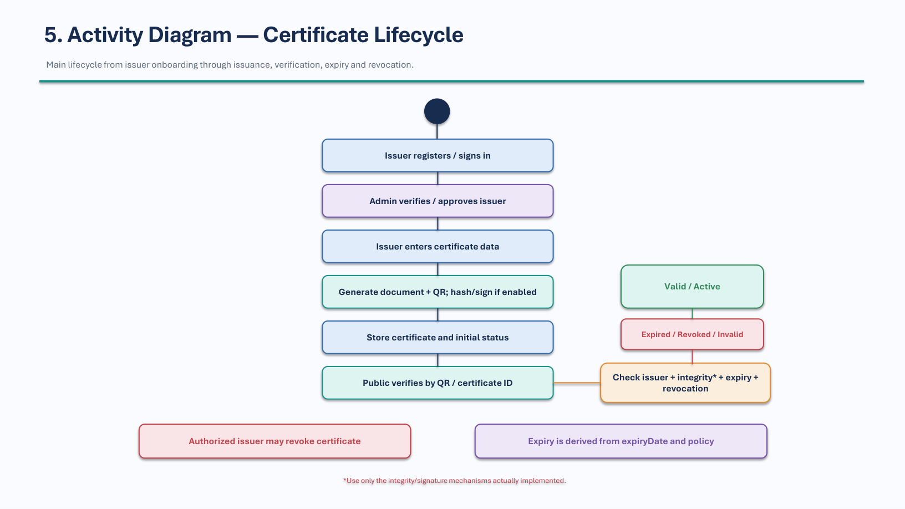

</details>

<details>
<summary><strong>6 · State Machine Diagram: Certificate Status</strong> — lifecycle states and transitions</summary>
<br/>

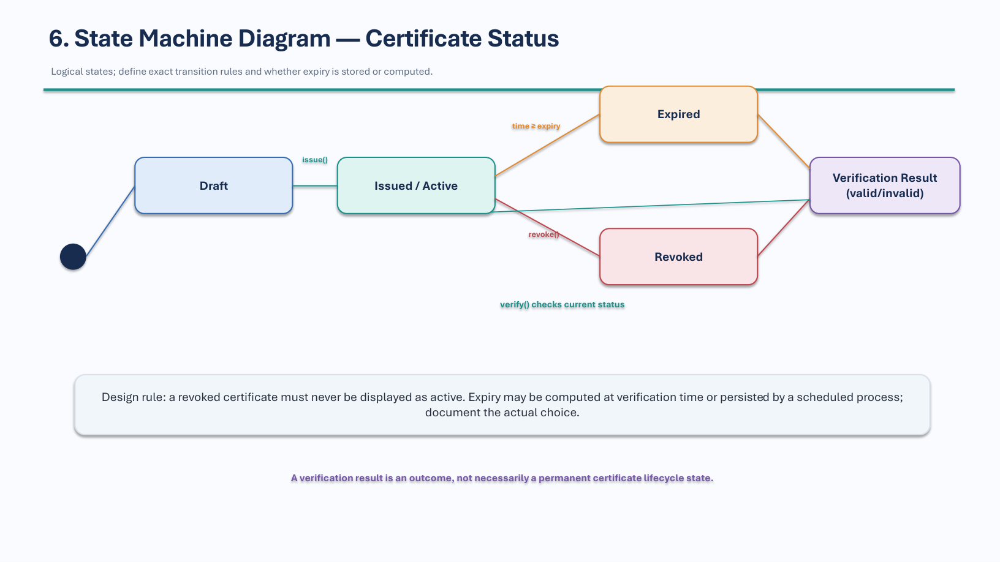

</details>

<details>
<summary><strong>7 · Component Diagram</strong> — logical software architecture</summary>
<br/>

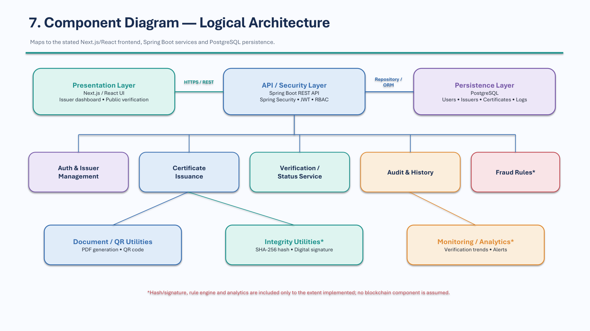

</details>

<details>
<summary><strong>8 · Deployment Diagram</strong> — conceptual hosting view</summary>
<br/>

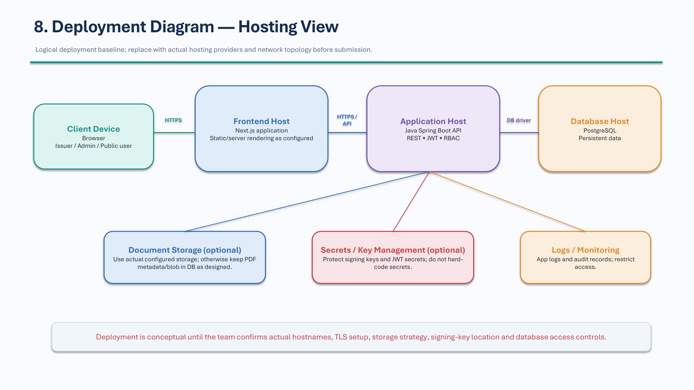

</details>

<details>
<summary><strong>9 · Design Constraints & Assumptions</strong> — implementation caveats</summary>
<br/>

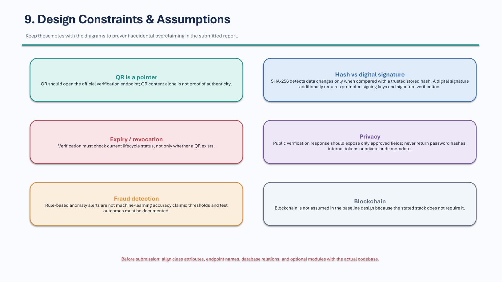

</details>

> **UML alignment note:** Some diagram fields, relationships and optional behaviors are illustrative. Align them with the actual entities, endpoints and database constraints before final academic submission. The baseline does not assume a blockchain component.

## 📁 Repository Structure

```text
Digital-Certificate-Platform/
├── frontend/
│   ├── public/
│   └── src/
│       ├── app/
│       │   ├── admin/
│       │   │   ├── analytics/
│       │   │   └── fraud/
│       │   ├── about/
│       │   ├── certificates/
│       │   │   ├── new/
│       │   │   └── [id]/
│       │   ├── features/
│       │   ├── holder/
│       │   ├── issuer/
│       │   ├── issuers/
│       │   ├── login/
│       │   ├── register/
│       │   ├── verify/
│       │   ├── components/
│       │   ├── context/
│       │   └── lib/
│       ├── package.json
│       └── vercel.json
├── backend/
│   ├── src/main/java/com/digitalcertificate/
│   │   ├── controller/
│   │   ├── dto/
│   │   ├── entity/
│   │   ├── exception/
│   │   ├── repository/
│   │   ├── security/
│   │   └── service/
│   ├── src/main/resources/
│   │   └── application.properties
│   ├── Dockerfile
│   ├── render.yaml
│   ├── pom.xml
│   └── mvnw / mvnw.cmd
├── database/
├── docs/
│   └── uml/
│       ├── Digital_Certificate_Platform_UML_Diagrams.pdf
│       └── images/
├── .gitignore
└── README.md
```

*This is a logical overview of the expected structure, not a guarantee that every listed directory contains files in every branch. Keep it aligned with the actual repository.*

## ⚙️ Getting Started

### Prerequisites

- JDK 21
- Node.js and npm
- PostgreSQL
- Git
- VS Code or another suitable editor

The included Maven Wrapper means a separate Maven installation is normally unnecessary.

### 1. Clone the repository

```bash
git clone https://github.com/PBL-Advanced-Java-Lab/Digital-Certificate-Platform.git
cd Digital-Certificate-Platform
```

### 2. Prepare PostgreSQL

Create a database named `digital_certificate_db`, or use the database name configured for your environment.

### 3. Start the backend

Open a terminal:

```powershell
cd backend
$env:DB_PASSWORD="YOUR_LOCAL_DATABASE_PASSWORD"
.\mvnw.cmd spring-boot:run
```

The default local backend URL is expected to be `http://localhost:8080` unless your configuration specifies another port.

### 4. Configure and start the frontend

Open a second terminal:

```powershell
cd frontend
npm install
```

Create `frontend/.env.local`:

```dotenv
NEXT_PUBLIC_API_URL=http://localhost:8080/api
```

Start the development server:

```powershell
npm run dev
```

Open `http://localhost:3000` or the URL shown in your terminal.

### 5. Verify the services

If the relevant health endpoints exist in your current branch, check:

- `http://localhost:8080/api/health`
- `http://localhost:8080/api/health/database`

Then test registration, login, issuer approval and certificate verification with non-sensitive test data.

## 🔌 API Overview

These routes are documented in the project progress report. Confirm their exact methods, authorization rules and response schemas in the current controller code before integration.

| Method | Endpoint | Purpose |
|---|---|---|
| `POST` | `/api/auth/register` | Register a user |
| `POST` | `/api/auth/login` | Authenticate a user |
| `GET` | `/api/auth/me` | Current user's profile |
| `GET` | `/api/certificate-types` | List certificate types |
| `POST` | `/api/certificate-types` | Create a certificate type (admin) |
| `POST` | `/api/certificates/issue` | Issue a certificate |
| `GET` | `/api/certificates/{id}` | Retrieve a certificate |
| `GET` | `/api/certificates/{id}/pdf` | Download certificate PDF |
| `PUT` | `/api/certificates/{id}/revoke` | Revoke a certificate |
| `GET` | `/api/certificates/my-issued` | Current issuer's certificates |
| `GET` | `/api/certificates/my-received` | Current holder's certificates |
| `GET` | `/api/public/verify/{certificateId}` | Public certificate verification |
| `GET` | `/api/issuers/directory` | Approved issuer directory |
| `GET` | `/api/analytics/overview` | Administrative analytics |
| `GET` | `/api/analytics/fraud-alerts` | Fraud alert list |
| `PUT` | `/api/analytics/fraud-alerts/{id}/resolve` | Resolve an alert |
| `GET` | `/api/analytics/logs` | Verification/audit logs |

## 🧪 Testing Checklist

Run the checks before merging changes or deploying.

**Backend**

```powershell
cd backend
$env:DB_PASSWORD="YOUR_LOCAL_DATABASE_PASSWORD"
.\mvnw.cmd clean test-compile
.\mvnw.cmd test
```

`test-compile` compiles main and test code; `test` runs the configured test suite.

**Frontend**

```powershell
cd frontend
npm run build
```

**Functional checks**

- [ ] Registration, duplicate email and invalid credentials
- [ ] Login and session restoration
- [ ] Role restrictions and protected endpoints
- [ ] Issuer application, approval and rejection
- [ ] Certificate issuance by an approved issuer only
- [ ] PDF download and QR destination
- [ ] Public verification for valid, unknown, expired, revoked and tampered certificates
- [ ] Hash and signature verification
- [ ] Public response privacy
- [ ] Verification logs, fraud alerts and analytics
- [ ] Production environment variables, CORS and HTTPS

## ☁️ Deployment

The repository includes a backend Dockerfile, a Render blueprint and Vercel configuration. Treat these as deployment starting points and validate them against the current hosting setup.

**Backend and database**
1. Provision managed PostgreSQL.
2. Deploy the Spring Boot service using `backend/Dockerfile` or a supported Java build.
3. Configure database access, JWT secret, CORS origins and signing-key storage in the provider's environment settings.
4. Check application logs and database connectivity.

**Frontend**
1. Import the repository into Vercel.
2. Set the root directory to `frontend`.
3. Set `NEXT_PUBLIC_API_URL` to the deployed API base URL.
4. Deploy and test key workflows over HTTPS.

Before production use, review authorization, key management, migrations, backups, rate limiting and operational logging.

## 👥 Team Contributions

CertiGuard is developed collaboratively in the [`PBL-Advanced-Java-Lab/Digital-Certificate-Platform`](https://github.com/PBL-Advanced-Java-Lab/Digital-Certificate-Platform) repository.

| Workstream | Areas of contribution |
|---|---|
| Frontend and UX | Public pages, authentication UI, dashboards, forms and responsive layouts |
| Backend and API | Spring Boot controllers, DTOs, services, validation and REST integration |
| Identity and issuer management | User/role entities, authentication and issuer approval |
| Certificate and cryptographic engine | Certificate persistence, hashing, RSA signatures, PDF and QR generation |
| Verification and governance | Public verification, lifecycle checks, logs, anomaly rules and analytics |
| Integration and delivery | API integration, testing, configuration, documentation and deployment preparation |

**Attribution:** Add individual names and specific contributions only after checking merged pull requests and commit history. This avoids incorrectly assigning work.

### Suggested Git workflow

```text
Feature branch → Pull Request → develop → Integration checks → Pull Request → main
```

Keep commits focused. Never commit `.env` files, passwords, JWT secrets or private keys.

## 🧭 Scope & Limitations

- The UML pack is a design reference and may need reconciliation with the implementation.
- Fraud detection is rule-based; do not describe it as machine learning unless a model is implemented and evaluated.
- A hash and a digital signature provide different security properties.
- Production readiness depends on end-to-end testing, secure signing-key management, database migrations and deployment safeguards.
- The baseline design does not assume blockchain.

## 🔮 Future Enhancements

- Managed signing-key storage, rotation and recovery procedures
- Automated integration tests and CI checks
- Stronger audit exports and reporting
- Configurable issuer accreditation and certificate templates
- Rate limiting and additional abuse controls
- Standards-based credential interoperability where required

## 🤝 Contributing

1. Create a feature branch from the team's integration branch.
2. Make a focused change and update tests.
3. Run backend tests and the frontend production build.
4. Review the diff and exclude secrets and local build files.
5. Open a pull request with a clear summary and test results.
6. Merge after review and required checks pass.

## 📄 License

No license has been specified yet. Add a `LICENSE` file and update this section if the team chooses to distribute the project under an open-source license.

---

<div align="center">

**CertiGuard — Trust every credential. Verify every certificate.**

Built as a collaborative full-stack academic project.

</div>
