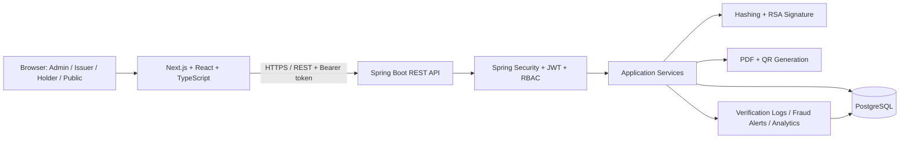

<div align="center">

# CertiGuard
### Digital Certificate Verification & Revocation Platform

**Trust every credential. Verify every certificate.**

A full-stack platform for issuing, managing, and publicly verifying digital certificates with lifecycle controls and cryptographic integrity checks.

[](https://www.oracle.com/java/)
[](https://spring.io/projects/spring-boot)
[](https://nextjs.org/)
[](https://www.typescriptlang.org/)
[](https://www.postgresql.org/)
[](#security-design)

</div>

---

## Table of Contents

- [Overview](#overview)
- [Problem Statement](#problem-statement)
- [Objectives](#objectives)
- [Key Features](#key-features)
- [User Roles](#user-roles)
- [How It Works](#how-it-works)
- [System Architecture](#system-architecture)
- [Technology Stack](#technology-stack)
- [Project Modules](#project-modules)
- [Security Design](#security-design)
- [UML Diagrams](#uml-diagrams)
- [Project Structure](#project-structure)
- [Prerequisites](#prerequisites)
- [Local Setup](#local-setup)
- [Configuration](#configuration)
- [API Overview](#api-overview)
- [Testing and Verification](#testing-and-verification)
- [Deployment](#deployment)
- [Team Contributions](#team-contributions)
- [Current Scope and Limitations](#current-scope-and-limitations)
- [Future Enhancements](#future-enhancements)
- [Contributing](#contributing)
- [License](#license)

## Overview

**CertiGuard** is a digital credential lifecycle platform designed to help organizations issue digital certificates and let recipients, employers, institutions, or other members of the public check them online. A certificate can be looked up using its certificate ID or the QR code printed on its generated PDF.

The platform combines role-based access, issuer onboarding and approval, certificate generation, public verification, expiry and revocation checks, verification logging, and rule-based anomaly alerts in one application.

> **Project principle:** A QR code is a link to the official verification experience—not proof of authenticity by itself. The server must check the certificate record and its current status.

## Problem Statement

Paper and static digital certificates can be difficult to authenticate at scale. Manual checks take time, while altered documents, revoked credentials, expired certificates, and untrusted issuers can create verification risks. CertiGuard provides a centralized verification flow and lifecycle controls to make certificate checks more consistent and auditable.

## Objectives

- Provide a digital workflow for issuer onboarding and approval.
- Generate certificate documents with unique identifiers and QR codes.
- Use SHA-256 hashes and RSA digital signatures to support integrity verification.
- Allow public certificate verification without requiring a user account.
- Track certificate status, including revocation and expiry.
- Provide role-specific dashboards and protected administrative operations.
- Record verification events and surface rule-based suspicious activity.
- Support deployment as a frontend application connected to a Java REST API and PostgreSQL.

## Key Features

- **Role-based access:** separate administrator, verified issuer, and certificate-holder experiences.
- **Issuer management:** submit issuer applications and approve or reject them through administrative workflows.
- **Certificate issuance:** issue credentials from an authorized issuer account.
- **PDF generation:** create a downloadable certificate document on the server.
- **QR code generation:** embed a QR code that points to the platform's verification route.
- **Cryptographic integrity:** calculate a SHA-256 digest and create/verify RSA signatures.
- **Public verification:** look up a certificate by ID or scan/upload a QR image.
- **Lifecycle controls:** check certificate expiry and revocation status.
- **Directories and dashboards:** browse approved issuers and certificate records according to access rules.
- **Verification logs and analytics:** record lookups and provide administrative summaries.
- **Rule-based fraud alerts:** flag configured patterns such as repeated invalid IDs or rapid lookups.

*Feature descriptions reflect the implementation progress report. Validate each workflow against the current code and tests before presenting it as fully production-verified.*

## User Roles

| Role | Main responsibilities |
|---|---|
| **System Administrator** | Manage users and issuer applications, approve/reject issuers, oversee certificate types, review audit/analytics and resolve alerts. |
| **Verified Issuer** | Manage its issuer workflow, issue certificates, view issued records and revoke certificates when authorized. |
| **Certificate Holder** | Access their own certificate records and download/share available certificate verification links. |
| **Public Visitor** | Verify a certificate by ID or QR code without logging in. |

Exact permissions are enforced by the backend; frontend navigation alone is not a security boundary.

## How It Works

1. **Register and authenticate.** A user creates an account and signs in. The backend authenticates the user and assigns permitted roles.
2. **Onboard an issuer.** An organization submits its issuer information. The application remains pending until an administrator reviews it.
3. **Approve the issuer.** An administrator approves or rejects the application. Approved issuers receive the permissions required for issuance.
4. **Issue a certificate.** An authorized issuer submits certificate details. The backend validates the request and stores certificate metadata.
5. **Generate the proof artifacts.** The system generates a SHA-256 hash, signs the canonical certificate data with the issuer's RSA private key, creates a QR code, and produces the PDF.
6. **Verify publicly.** A visitor opens the QR link or enters the certificate ID. The server retrieves the record and checks the current status, expiry, hash, and signature.
7. **Return a safe result.** The public page displays the verification outcome and only the approved public fields.
8. **Maintain the lifecycle.** Authorized users can revoke certificates. Verification activity is logged and configured anomaly rules can raise alerts.

## System Architecture



The frontend and backend are separate applications. The backend is responsible for authorization, validation, cryptographic verification, persistence, and authoritative certificate generation.

## Technology Stack

| Layer | Technology | Responsibility |
|---|---|---|
| Frontend | Next.js, React, TypeScript | Public pages, authentication views, dashboards, certificate forms and verification UI |
| Styling | Tailwind CSS and project design tokens | Responsive, consistent UI |
| Backend | Java 21, Spring Boot | REST API, business logic and certificate lifecycle |
| Security | Spring Security, JWT, BCrypt, RBAC | Authentication, password hashing and authorization |
| Persistence | Spring Data JPA / Hibernate | Entity mapping and database access |
| Database | PostgreSQL | Users, roles, issuers, certificates and event records |
| Cryptography | SHA-256, RSA / `SHA256withRSA` | Certificate integrity digest and digital signatures |
| PDF | OpenPDF | Server-side certificate generation |
| QR | ZXing | QR code creation |
| Browser QR decoding | `jsqr` and browser camera APIs | Decode QR images and camera frames in the frontend |
| Build | Maven Wrapper, npm | Reproducible backend and frontend build commands |
| Hosting target | Vercel + Render or equivalent | Frontend hosting and backend/database hosting |

## Project Modules

1. **Authentication and Identity Management** — registration, login, user profiles, JWT-based authentication and role-based authorization.
2. **Issuer Management** — issuer registration, approval/rejection and issuer trust information.
3. **Certificate Types and Issuance** — configurable types, issue form, certificate metadata and authoritative PDF.
4. **Cryptographic Services** — canonical certificate data, SHA-256 hash, RSA signature generation and verification.
5. **QR and Public Verification** — QR decoding, public verification endpoint, privacy-aware response and status presentation.
6. **Lifecycle, Audit and Analytics** — expiry/revocation, verification logs, rule-based alerts, administrative audit and analytics.

## Security Design

- **Password storage:** passwords should be stored as BCrypt hashes, never as plaintext.
- **Authentication:** protected API requests use the configured authentication mechanism and JWT where enabled.
- **Authorization:** backend endpoints must check roles and resource ownership; hiding a button in the UI is not sufficient.
- **Issuer approval:** only approved issuers should be permitted to issue certificates.
- **Integrity:** SHA-256 is used to calculate a digest; it must be compared with a trusted value. A hash alone does not authenticate who issued a certificate.
- **Digital signatures:** the RSA signature must be verified against the issuer's trusted public key. Signing keys must be protected.
- **Privacy:** public verification responses should not expose password hashes, private keys, tokens, or internal audit metadata.
- **Lifecycle:** verification must consider current expiry and revocation status—not merely whether a QR code exists.
- **Secrets:** database credentials, JWT secrets and private keys must be supplied through environment variables or a proper secret-management system. Never commit them.
- **Transport:** production deployments should use HTTPS.

**Important key-management note:** The current progress report describes issuer RSA private-key material in database-backed fields. Before production use, assess this design and move private keys to protected secret/key storage or encrypt them at rest with tightly restricted access. Do not expose private-key fields through API responses.

## UML Diagrams

The complete UML reference PDF is included at [`docs/uml/Digital_Certificate_Platform_UML_Diagrams.pdf`](docs/uml/Digital_Certificate_Platform_UML_Diagrams.pdf). It contains the following diagrams and design notes:

| Diagram | What it explains | PDF page |
|---|---|---:|
| Use Case Diagram | Actors and system functions | 2 |
| Domain Class Diagram | Core entities and relationships | 3 |
| Sequence Diagram — Certificate Issuance | Issuance interactions between UI, API, services and storage | 4 |
| Sequence Diagram — Public Verification | Public lookup and server-side checks | 5 |
| Activity Diagram — Certificate Lifecycle | Issuer onboarding through issue, verify, expiry and revocation | 6 |
| State Machine Diagram — Certificate Status | Logical lifecycle states and transitions | 7 |
| Component Diagram — Logical Architecture | Frontend, API, services and persistence | 8 |
| Deployment Diagram — Hosting View | Conceptual frontend/API/database deployment | 9 |
| Design Constraints & Assumptions | Security and implementation caveats | 10 |

### Diagram previews

The source PDF is the authoritative bundled reference. To embed individual diagrams directly in GitHub's README, export the corresponding PDF pages to PNG and commit them under `docs/uml/images/`. Then replace the commented examples below with the matching image paths.

<details>
<summary><strong>1. Use Case Diagram</strong></summary>


</details>

<details>
<summary><strong>2. Domain Class Diagram</strong></summary>


</details>

<details>
<summary><strong>3. Sequence Diagram — Certificate Issuance</strong></summary>


</details>

<details>
<summary><strong>4. Sequence Diagram — Public Verification</strong></summary>


</details>

<details>
<summary><strong>5. Activity Diagram — Certificate Lifecycle</strong></summary>


</details>

<details>
<summary><strong>6. State Machine Diagram — Certificate Status</strong></summary>


</details>

<details>
<summary><strong>7. Component Diagram — Logical Architecture</strong></summary>


</details>

<details>
<summary><strong>8. Deployment Diagram — Hosting View</strong></summary>


</details>

<details>
<summary><strong>9. Design Constraints and Assumptions</strong></summary>


</details>

> **Documentation accuracy:** the supplied diagrams label some entities, fields, relationships, storage choices, and fraud/analytics behavior as illustrative or optional. Reconcile them with the actual code and database schema before academic submission. The baseline does not assume blockchain.

## Project Structure

The following is a **logical overview** of the repository. Keep the actual package and file names in GitHub aligned with the codebase; this diagram does not imply that every optional folder exists.

```text
Digital-Certificate-Platform/
├── frontend/
│   ├── public/
│   ├── src/
│   │   ├── app/
│   │   │   ├── admin/
│   │   │   │   ├── analytics/
│   │   │   │   └── fraud/
│   │   │   ├── about/
│   │   │   ├── certificates/
│   │   │   │   ├── new/
│   │   │   │   └── [id]/
│   │   │   ├── features/
│   │   │   ├── holder/
│   │   │   ├── issuer/
│   │   │   │   └── register/
│   │   │   ├── issuers/
│   │   │   ├── login/
│   │   │   ├── register/
│   │   │   ├── verify/
│   │   │   │   └── [certificateId]/
│   │   │   ├── layout.tsx
│   │   │   ├── page.tsx
│   │   │   └── globals.css
│   │   ├── components/
│   │   │   └── dashboard/
│   │   ├── context/
│   │   └── lib/
│   │       └── api.ts
│   ├── package.json
│   └── vercel.json
├── backend/
│   ├── src/main/java/com/digitalcertificate/
│   │   ├── controller/
│   │   ├── dto/
│   │   ├── entity/
│   │   ├── exception/
│   │   ├── repository/
│   │   ├── security/
│   │   └── service/
│   ├── src/main/resources/
│   │   └── application.properties
│   ├── Dockerfile
│   ├── render.yaml
│   ├── pom.xml
│   └── mvnw / mvnw.cmd
├── database/
│   └── [database scripts, if maintained]
├── docs/
│   └── uml/
│       ├── Digital_Certificate_Platform_UML_Diagrams.pdf
│       └── images/
├── .gitignore
└── README.md
```

## Prerequisites

Install the following before running the project:

- Java Development Kit (JDK) 21
- Node.js and npm compatible with the frontend lockfile
- PostgreSQL
- Git
- A code editor such as Visual Studio Code

The Maven Wrapper (`mvnw` / `mvnw.cmd`) is included, so a separate Maven installation is not normally required.

## Local Setup

### 1. Clone the repository

```bash
git clone https://github.com/PBL-Advanced-Java-Lab/Digital-Certificate-Platform.git
cd Digital-Certificate-Platform
```

### 2. Create the PostgreSQL database

Create a database named `digital_certificate_db` in your local PostgreSQL instance, or use the database name configured for your environment.

### 3. Configure the backend

Review `backend/src/main/resources/application.properties`. Configure the datasource and other settings using environment variables. Do not commit credentials.

Example PowerShell session:

```powershell
cd backend
$env:DB_PASSWORD="YOUR_LOCAL_DATABASE_PASSWORD"
.\mvnw.cmd spring-boot:run
```

The backend is expected to run on `http://localhost:8080` when using the default local configuration.

### 4. Configure and run the frontend

Open a second terminal:

```powershell
cd frontend
npm install
```

Create `frontend/.env.local` and set the API base URL:

```dotenv
NEXT_PUBLIC_API_URL=http://localhost:8080/api
```

Then start the development server:

```powershell
npm run dev
```

Open `http://localhost:3000` unless Next.js prints a different local URL.

### 5. Verify the local setup

- Open the landing page and confirm it renders.
- Test `http://localhost:8080/api/health` if the health endpoint is enabled.
- Test `http://localhost:8080/api/health/database` if the database health endpoint is enabled.
- Register/login with test credentials.
- Verify the issuer onboarding and certificate lifecycle using test data.

> Endpoint availability can change as the code evolves. If a health endpoint is absent in your branch, use the actual health route implemented in the backend.

## Configuration

| Variable | Purpose | Example / guidance |
|---|---|---|
| `DB_PASSWORD` | Local database password, if referenced by `application.properties` | Keep in the shell environment |
| `DATABASE_URL` | Hosted database connection string, if supported by the deployed configuration | Configure in the hosting provider's secret settings |
| `JWT_SECRET` | Secret used to sign JWTs, if configured by the application | Use a strong, unique production secret |
| `CORS_ALLOWED_ORIGINS` | Allowed frontend origins, if read by the backend configuration | Include local and deployed frontend origins explicitly |
| `NEXT_PUBLIC_API_URL` | Frontend API base URL | `http://localhost:8080/api` locally; HTTPS API URL in production |

The backend configuration must explicitly support any hosted variable listed above. Do not assume that setting `DATABASE_URL` automatically configures Spring Boot unless the application or deployment configuration maps it to the datasource.

## API Overview

The following routes are documented in the project progress report. Confirm the exact HTTP methods, authorization rules, and response bodies against the current controllers before relying on them.

| Method | Endpoint | Purpose |
|---|---|---|
| `POST` | `/api/auth/register` | Register a user |
| `POST` | `/api/auth/login` | Authenticate a user |
| `GET` | `/api/auth/me` | Retrieve the authenticated user's profile |
| `GET` | `/api/certificate-types` | List certificate types |
| `POST` | `/api/certificate-types` | Create a certificate type (admin) |
| `POST` | `/api/certificates/issue` | Issue a certificate (authorized issuer) |
| `GET` | `/api/certificates/{id}` | Retrieve a certificate (authorization applies) |
| `GET` | `/api/certificates/{id}/pdf` | Download a certificate PDF |
| `PUT` | `/api/certificates/{id}/revoke` | Revoke a certificate (authorized user) |
| `GET` | `/api/certificates/my-issued` | List certificates issued by the current issuer |
| `GET` | `/api/certificates/my-received` | List certificates available to the current holder |
| `GET` | `/api/public/verify/{certificateId}` | Public certificate verification |
| `GET` | `/api/issuers/directory` | List approved issuers |
| `GET` | `/api/analytics/overview` | Administrative analytics |
| `GET` | `/api/analytics/fraud-alerts` | Retrieve fraud alerts (admin) |
| `PUT` | `/api/analytics/fraud-alerts/{id}/resolve` | Resolve a fraud alert (admin) |
| `GET` | `/api/analytics/logs` | Administrative verification/audit logs |

Use the configured API base URL when calling these routes. Public routes should return only approved public fields; administrative and personal routes must enforce server-side authorization.

## Testing and Verification

Run these checks before merging or deploying changes.

### Backend

```powershell
cd backend
$env:DB_PASSWORD="YOUR_LOCAL_DATABASE_PASSWORD"
.\mvnw.cmd clean test-compile
```

To execute the test suite (when tests are present):

```powershell
.\mvnw.cmd test
```

`test-compile` verifies compilation of test sources; it does **not** execute the tests.

### Frontend

```powershell
cd frontend
npm run build
```

### Functional test checklist

- [ ] New user registration and duplicate-email handling
- [ ] Login success, wrong password, and session restoration
- [ ] Role restrictions and protected API routes
- [ ] Issuer application, approval, and rejection
- [ ] Certificate issuance by an approved issuer only
- [ ] PDF download and QR destination
- [ ] Public verification of valid, unknown, expired, revoked and tampered certificates
- [ ] Signature and hash verification against stored trusted data
- [ ] Public response privacy checks
- [ ] Verification log and fraud-alert behavior
- [ ] Administrative analytics and alert resolution
- [ ] Production environment variables, CORS and HTTPS

## Deployment

The repository includes a backend Dockerfile, a Render deployment blueprint, and a Vercel configuration. These are starting points and should be checked against the actual provider configuration.

### Backend and database

1. Provision a managed PostgreSQL database.
2. Deploy the Spring Boot backend using `backend/Dockerfile` or a provider-supported Java build.
3. Configure the datasource URL/credentials, JWT secret, CORS origins and any signing-key configuration in the provider's environment settings.
4. Confirm database connectivity and health checks in the hosted logs.

### Frontend

1. Import the repository into Vercel.
2. Set the project root directory to `frontend`.
3. Set `NEXT_PUBLIC_API_URL` to the deployed backend API base URL, including `/api` if expected by `frontend/src/lib/api.ts`.
4. Deploy and test registration, login, public verification, PDF download and role-protected actions over HTTPS.

Before production use, confirm CORS, key storage, database migrations, backup/restore, log privacy, rate limiting and authorization boundaries.

## Team Contributions

CertiGuard is maintained as a collaborative project in the `PBL-Advanced-Java-Lab/Digital-Certificate-Platform` repository. Work is organized by feature and integrated through Git branches and pull requests.

| Workstream | Contribution areas |
|---|---|
| Frontend and user experience | Public landing/verification pages, authentication views, role dashboards, certificate forms and responsive UI |
| Backend and API | Spring Boot controllers, DTOs, services, validation and REST integration |
| Identity and issuer management | User/role entities, authentication, issuer registration and approval workflows |
| Certificate and cryptographic engine | Certificate persistence, SHA-256 hashing, RSA signing/verification, PDF and QR generation |
| Verification, audit and analytics | Public verification, lifecycle checks, event logging, anomaly rules and dashboards |
| Integration and delivery | API client integration, builds, functional testing, configuration, documentation and deployment preparation |

**Attribution note:** This table lists project workstreams, not verified individual authorship. Add each teammate's name, branch, and specific merged contribution only after confirming the repository history and pull requests.

### Suggested Git workflow

```text
feature branch → Pull Request → develop → integration checks → Pull Request → main
```

Keep commits focused, review the diff before merging, and never commit `.env` files, passwords, JWT secrets or private keys.

## Current Scope and Limitations

- The bundled UML diagrams are design references. Some class attributes, relationship multiplicities, endpoint names and optional modules may need reconciliation with the implementation.
- Fraud detection is rule-based. It should not be described as machine-learning detection unless an ML model is actually implemented and evaluated.
- SHA-256 and RSA signatures provide different protections; a hash is not a substitute for signature verification.
- Production readiness depends on end-to-end tests, secure private-key management, proper database migrations, deployment configuration and operational safeguards.
- No blockchain component is assumed by the baseline design.

## Future Enhancements

- Hardware-backed or managed key storage with key rotation and revocation procedures.
- Stronger audit retention, export and reporting controls.
- Configurable issuer accreditation and certificate templates.
- Rate limiting, abuse monitoring and accessibility improvements.
- Automated integration tests and continuous integration checks.
- Standards-based credential interoperability where required by the use case.

## Contributing

1. Create a feature branch from the team's integration branch.
2. Make a focused change and add/update tests.
3. Run backend compilation/tests and the frontend production build.
4. Review `git diff` and ensure no secrets or generated local files are included.
5. Open a pull request with a clear summary, test results and screenshots when relevant.
6. Merge only after review and successful checks.

## License

No license has been specified in this README. Add a `LICENSE` file and update this section if the team decides to distribute the project under an open-source license.
